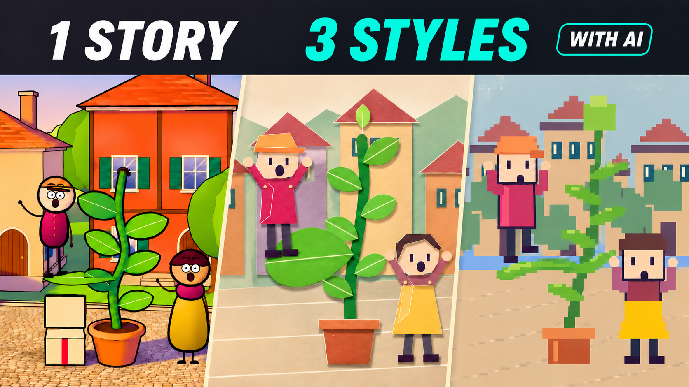

# The delivery that became a garden



A 52-second animated short and two interpretations of the same scene, created with AI assistance and editable code. This follows **Entrega pelo ar**: Nico delivers a tiny seed and the square gains shade.

## Download and watch

On GitHub, select **Code → Download ZIP**. Extract the folder and open **index.html** in your browser. The index contains the actual documents, a copyable prompt and local videos. No installation is needed to watch the MP4 files.

- `media/jardim-25d.mp4`: the complete 52-second short.
- `media/jardim-papel.mp4` and `media/jardim-pixel.mp4`: ten-second interpretations of the same 00:20–00:30 passage.
- `projeto/`: full editable code, audio, pinned dependencies and rendering scripts.
- `STARTER-PROMPT.txt`: English starter prompt; `PROMPT-INICIAL.txt` is Portuguese.
- `docs/PROCESSO-REAL.md` and `docs/PROMPTS-USADOS.json`: actual Portuguese messages used for briefing and review, including the correction of the time interval.
- `skills/historia-animada/SKILL.md`: portable production instructions.
- `qa/`: technical verification of the final outputs.

## Run the project

Requirements: Node.js 22 or newer and npm. In a terminal inside the extracted folder:

```powershell
cd projeto
npm ci
npm run check
npm run studio
```

Open the local address printed by Studio. It does not open windows automatically. To render:

```powershell
npm run render
npm run render:paper
npm run render:pixel
```

Outputs go into `media/` beside `projeto/`. These commands can replace the included samples, so work in a copy to preserve them. Rendering uses concurrency 1 but still consumes CPU/GPU. For a smaller preview:

```powershell
node scripts/render.mjs Jardim25D ../media/my-preview.mp4 0.5
```

The required audio is already included in `projeto/public/mix.mp3`. Python and FFmpeg are only needed to regenerate the music and sound effects. See `projeto/README.md`.

## What the AI did

Claude was used for briefing and review; Codex implemented and rendered the project. The three styles use deterministic code, not three generative video models. The workflow included revisions to contact, continuity, character identity and shadows.

Music and sound effects were synthesized locally. The kit includes no cloned presenter voice, API keys or private files. New code and documentation are MIT licensed; the adapted base's provenance is preserved in `CREDITOS.md` and `LICENSE-MROMIDEV`. Dependencies retain their own license terms.

Previous tutorial: https://www.luiz-amorim.com/en/prompts/animated-shorts-with-ai/
Channel: https://www.youtube.com/@LuizAmorimIA
