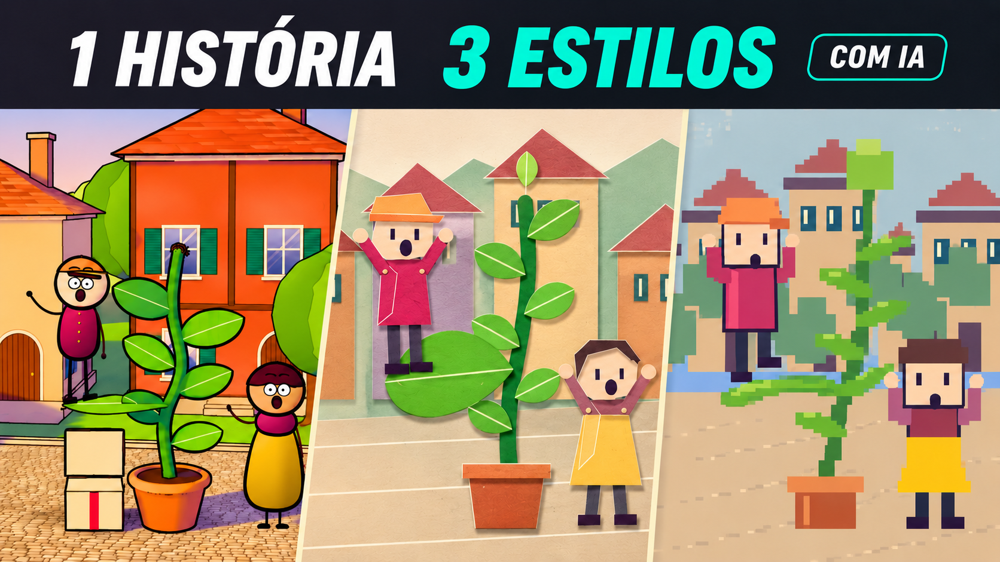

# A entrega que virou jardim

**Assista ao tutorial:** [Como criar uma nova história animada com IA](https://youtu.be/gETGaHPne3c)

**Prompts e guia:** [Página deste episódio](https://www.luiz-amorim.com/pt/prompts/nova-historia-animada-com-ia/)



Um curta de 52 segundos e duas interpretações da mesma cena, produzidos com assistência de IA e código editável. Semi-continuação de **Entrega pelo ar**, com Nico, uma semente minúscula e uma praça que ganha sombra.

**Comece por [COMECE-AQUI.md](COMECE-AQUI.md).** English: [README.en.md](README.en.md).

## Baixar e abrir

No GitHub, clique em **Code → Download ZIP**. Extraia a pasta e abra **index.html** no navegador: ele reúne os documentos, o prompt copiável e os vídeos locais. Não precisa instalar nada para assistir aos MP4s.

O kit contém:

- `media/jardim-25d.mp4`: curta principal, 52 segundos.
- `media/jardim-papel.mp4` e `media/jardim-pixel.mp4`: o mesmo intervalo narrativo de 00:20–00:30, dez segundos em cada estilo.
- `projeto/`: código completo, áudio, dependências fixadas e scripts de reprodução.
- `PROMPT-INICIAL.txt`: prompt inicial em português; `STARTER-PROMPT.txt` em inglês.
- `docs/PROCESSO-REAL.md` e `docs/PROMPTS-USADOS.json`: pedidos reais enviados ao Claude para briefing/revisão, incluindo a correção do intervalo e escolha do 2.5D.
- `skills/historia-animada/SKILL.md`: instruções portáteis de produção.
- `qa/`: relatório técnico final e origem.

## Executar o projeto

Requisitos: Node.js 22 ou mais recente e npm. Abra um terminal na pasta extraída:

```powershell
cd projeto
npm ci
npm run check
npm run studio
```

Abra o endereço local informado. O Studio não abre janelas automaticamente. Para repetir os renders:

```powershell
npm run render
npm run render:paper
npm run render:pixel
```

O resultado é salvo em `media/`, ao lado de `projeto/`. Os arquivos de exemplo podem ser substituídos; trabalhe numa cópia se quiser preservá-los. O render usa concorrência 1, mas ainda consome CPU/GPU. Para uma prévia menor:

```powershell
node scripts/render.mjs Jardim25D ../media/minha-previa.mp4 0.5
```

O áudio necessário já está em `projeto/public/mix.mp3`. Python e FFmpeg só são necessários para refazer a música/efeitos; instruções em [projeto/README.md](projeto/README.md).

## O que a IA fez

Claude foi usado para briefing e revisão; Codex implementou e renderizou. Os três estilos foram produzidos por código determinístico, não por três modelos de vídeo generativo. O processo incluiu ajustes de contato físico, continuidade, identidade e sombra. [Processo real](docs/PROCESSO-REAL.md) e [log de execução](projeto/LOG-EXECUCAO.md).

A música e os efeitos do curta foram sintetizados localmente. O kit não inclui a voz clonada do apresentador, chaves de API ou arquivos privados. Código e documentação novos sob MIT; proveniência da base preservada em [CREDITOS.md](CREDITOS.md) e [LICENSE-MROMIDEV](LICENSE-MROMIDEV). Confira também os termos próprios das dependências.

Tutorial anterior: https://www.luiz-amorim.com/pt/prompts/shorts-animados-com-ia/
Canal: https://www.youtube.com/@LuizAmorimIA
